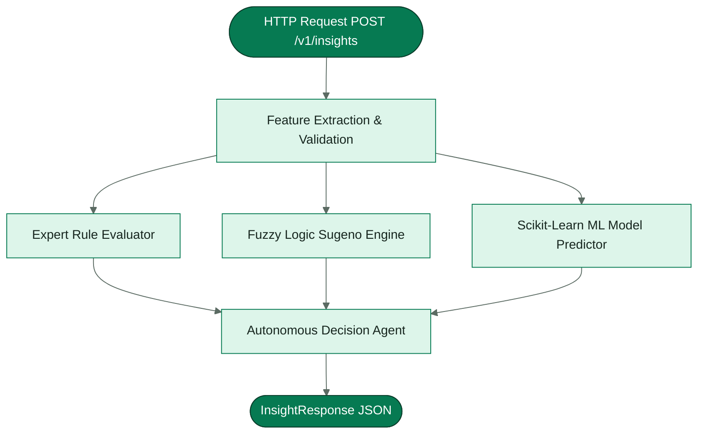
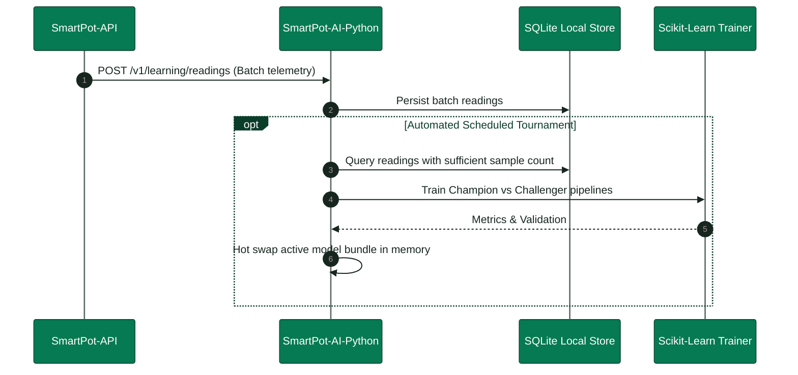
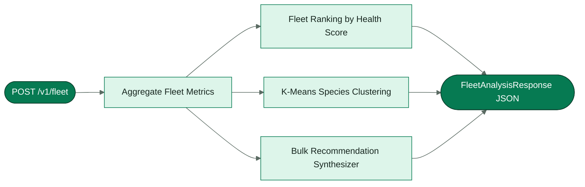

<!-- portada
eyebrow: Component Technical Documentation
titulo: SmartPot-AI-Python (Legacy Stack A)
acento: AI
subtitulo: Legacy Intelligent Agronomic Assistant
bajada: Legacy Python inference engine: expert systems, fuzzy logic, machine learning pipelines, reactive rule evaluation, and continuous learning telemetry ingestion.
documento: SmartPot-AI-Python Documentation
version: 1.2 · October 2026
equipo: SmartPotTech
proyecto: smartpot.app
-->

# SmartPot-AI-Python (Legacy Stack A)

> [!WARNING]
> **Componente Legado (Stack A)**: Este componente monolítico en Python ha sido reemplazado en producción por la inferencia en Rust ([`SmartPot-AI`](https://github.com/SmartPotTech/SmartPot-AI)) y el servicio desacoplado de entrenamiento ([`SmartPot-Trainer`](https://github.com/SmartPotTech/SmartPot-Trainer)). Este documento describe la implementación original monolítica como registro histórico.

## Document Summary

| Field                          | Value                                                                                                                                                                                                                                                                                                                                                                                                                                                   |
|--------------------------------|---------------------------------------------------------------------------------------------------------------------------------------------------------------------------------------------------------------------------------------------------------------------------------------------------------------------------------------------------------------------------------------------------------------------------------------------------------|
| Proyecto                       | SmartPot · [smartpot.app](https://smartpot.app)                                                                                                                                                                                                                                                                                                                                                                                                         |
| Componente                     | [SmartPot-AI](https://github.com/SmartPotTech/SmartPot-AI)                                                                                                                                                                                                                                                                                                                                                                                              |
| Versión                        | 1.2 · octubre 2026                                                                                                                                                                                                                                                                                                                                                                                                                                      |
| Alcance                        | Cómo razona el asistente, aprendizaje continuo, análisis de flota, contrato, configuración, pruebas y operación                                                                                                                                                                                                                                                                                                                                         |
| Platform Documentation | [Technical Documentation](https://github.com/SmartPotTech/.github/blob/main/docs/SmartPot_Technical_Documentation.md), [Project Journey](https://github.com/SmartPotTech/.github/blob/main/docs/SmartPot_Project_Journey.md), [Software Lifecycle](https://github.com/SmartPotTech/.github/blob/main/docs/SmartPot_Software_Lifecycle.md), and [Global Diagrams](https://github.com/SmartPotTech/.github/blob/main/docs/README.md#global-diagrams) |
| Maintenance                  | Generated from `docs/` in this repository via `.github/docs/tools`; updated with every component change                                                                                                                                                                                                                                                                                                                   |

<!-- parte: PART I | Component Overview -->

## 1. Purpose

### In Plain Terms

SmartPot-AI es el agrónomo de la plataforma. La API le manda la última lectura de un cultivo, su historial, sus
actuadores, dónde está y el clima de afuera; el asistente responde cómo está (un índice de salud de 0 a 100), por qué, qué va a pasar en las próximas
horas y qué conviene hacer. Además aprende sin parar de las lecturas de los cultivos reales de cada especie, sin saber
de qué cuenta viene cada una. Es un servicio interno: solo la API lo consulta, con un token.

| Técnica                | Qué resuelve                                                                           |
|------------------------|----------------------------------------------------------------------------------------|
| Sistema experto        | Diagnóstico por variable y conclusiones encadenadas con su explicación                 |
| Lógica difusa          | Índice de salud que tolera la incertidumbre de los sensores                            |
| Aprendizaje automático | Ventilación, corrección de pH y lecturas atípicas                                      |
| Pronóstico             | Tendencia de cada variable y horas hasta salir del rango                               |
| Agente reactivo        | Acciones sobre los actuadores que el cultivo sí tiene                                  |
| Análisis de flota      | Ranking, problemas del entorno, grupos y acciones en bloque                            |
| Consejo de lugar       | Si el lugar le sirve a la especie y cuándo conviene moverla                            |
| Aprendizaje continuo   | Modelos que mejoran con las lecturas reales y solo reemplazan al vigente si lo superan |
| Aceleración C++ nativa | Cómputo numérico directo en C++20 (Theil-Sen $O(M)$ lineal, Sugeno SIMD, calidad IQR y normalización) con C ABI y fallback |

## 2. Component Architecture

```mermaid
%%{init: {"theme": "base", "fontFamily": "Segoe UI, Arial, sans-serif", "themeVariables": {"fontFamily": "Segoe UI, Arial, sans-serif", "fontSize": "15px", "primaryColor": "#DDF5EA", "primaryTextColor": "#17261F", "primaryBorderColor": "#067A52", "secondaryColor": "#E3F2FB", "secondaryTextColor": "#17261F", "secondaryBorderColor": "#1F6FA0", "tertiaryColor": "#F2F7F4", "tertiaryTextColor": "#17261F", "tertiaryBorderColor": "#D5E3DC", "lineColor": "#5B6B63", "textColor": "#17261F", "mainBkg": "#DDF5EA", "nodeBorder": "#067A52", "clusterBkg": "#F7FAF8", "clusterBorder": "#D5E3DC", "edgeLabelBackground": "#FFFFFF", "actorBkg": "#067A52", "actorBorder": "#0B3D2B", "actorTextColor": "#FFFFFF", "actorLineColor": "#5B6B63", "signalColor": "#17261F", "signalTextColor": "#17261F", "labelBoxBkgColor": "#0B3D2B", "labelBoxBorderColor": "#0B3D2B", "labelTextColor": "#FFFFFF", "loopTextColor": "#0B3D2B", "noteBkgColor": "#FDF4DD", "noteBorderColor": "#C98D12", "noteTextColor": "#17261F", "activationBkgColor": "#DDF5EA", "activationBorderColor": "#067A52", "attributeBackgroundColorOdd": "#FFFFFF", "attributeBackgroundColorEven": "#F2F7F4"}, "layout": "elk", "elk": {"nodePlacementStrategy": "BRANDES_KOEPF", "mergeEdges": false, "cycleBreakingStrategy": "GREEDY"}}}%%
flowchart LR
  api["SmartPot-API"]
  subgraph svc["SmartPot-AI-Python · FastAPI · Python 3.13"]
    direction TB
    auth["Constant-Time Token Auth"]
    engine["Hybrid Engine: Expert Rules + Fuzzy + ML"]
    db[("SQLite Local Store")]
  end
  api -->|"REST HTTP :8000"| auth --> engine
  engine <--> db
  classDef core fill:#067A52,stroke:#0B3D2B,color:#FFFFFF
  classDef leaf fill:#DDF5EA,stroke:#067A52,color:#17261F
  class api core
  class svc,auth,engine,db leaf
```

<!-- diagrama: SmartPot_AI_Global_Component | titulo=SmartPot-AI Component Architecture | lamina=H -->

### Native C++20 Acceleration Module

Para optimizar de forma extrema la latencia, el uso de memoria RAM y la escalabilidad concurrente bajo ráfagas intensivas de peticiones, los algoritmos numéricos de cálculo pesado han sido reescritos directamente en **C++20** (`src/native/`):

- **Estimador Theil-Sen $O(M)$ Lineal**: El cálculo tradicional de Theil-Sen requiere comparar todos los pares de lecturas temporales ($M = N(N-1)/2$). En Python/NumPy esto creaba matrices temporales masivas (`np.triu_indices`) y ordenaciones $O(M \log M)$. En C++20, se utiliza selección lineal en tiempo $O(M)$ con `std::nth_element`, logrando entre **3.6x y 50x de aceleración** con huella de memoria nula y cero fragmentación del heap.
- **Inferencia Difusa Sugeno Vectorizada**: Funciones de pertenencia trapezoidal branchless (sin saltos condicionales) y ponderación de reglas mediante constantes en tiempo de compilación (`constexpr`), con cálculo en tiempo sub-milisegundo.
- **Control de Calidad de Datos (IQR)**: Evaluación de completitud, validación física contra límites de sensores y detección de espigas anómalas en lotes de hasta 20 000 lecturas mediante percentiles en tiempo lineal.
- **Transformación de Características y Codificación Circular**: Normalización de tolerancia relativa y codificación trigonométrica continua de hora solar ($\sin$, $\cos$).
- **C ABI y Fallback Transparente**: Enlazado mediante `ctypes` (`app/engine/native_bridge.py`) con estructuras de memoria empaquetadas a 8 bytes (`#pragma pack(push, 8)`). Si la biblioteca no está compilada en el entorno, el sistema degrada de manera transparente a las rutinas estándar de Python garantizando 100% de disponibilidad.

<!-- parte: PART II | Agronomic Reasoning Pipeline -->

## 3. Cómo razona una evaluación

<!-- diagrama: SmartPot_AI_01_Insight_Pipeline | titulo=De la lectura a la respuesta -->

| Paso                 | Detalle                                                                                                                                                                                                                                   |
|----------------------|-------------------------------------------------------------------------------------------------------------------------------------------------------------------------------------------------------------------------------------------|
| Base de conocimiento | Rangos ideales de lechuga, tomate, fresa, albahaca, espinaca y pimentón en la escala de los sensores; una variable fuera de rango se mide en tolerancias y desde una completa es crítica                                                  |
| Noche                | Entre las 22:00 y las 6:00 la luz baja es descanso (`REST`) y no resta salud                                                                                                                                                              |
| Modelos base         | Se entrenan al arrancar con 4000 muestras sintéticas y semilla fija; `GET /v1/models` informa su exactitud                                                                                                                                |
| Reglas               | Encadenamiento hacia adelante con prioridades; `sensor_fault` bloquea las acciones si la lectura es imposible                                                                                                                             |
| Agente               | Riego (no con lluvia sobre un cultivo al aire libre), luz ultravioleta de día (y apagarla de noche), ventilación, humidificador y dosificadores, solo si el cultivo tiene el actuador; la API aplica el enfriamiento y el modo automático |
| Lugar y clima        | Con `placement` y `weather`: consejo `OK`, `UNKNOWN`, `TIP` o `MOVE` según la luz que pide la especie; reglas `rain_outside` (0,5 mm o más) y `sensor_vs_outside` (8 °C o más de diferencia con el clima)                                 |

## 4. Continuous Learning Engine

<!-- diagrama: SmartPot_AI_02_Learning_Cycle | titulo=Ciclo del aprendizaje continuo | lamina=H -->

Solo aprende de cultivos **reales**: la API no envía las lecturas de los cultivos virtuales, que son sintéticas. Cada
especie entrena por separado y en un proceso aparte para no frenar las evaluaciones; una tarea queda pendiente, con su
razón, mientras falten datos o casos. Borrar un cultivo borra sus lecturas.

## 5. Fleet Analysis and Clustering

<!-- diagrama: SmartPot_AI_03_Fleet_Analysis | titulo=Análisis de todos los cultivos de una cuenta -->

<!-- parte: PART III | Operations & Verification -->

## 6. Contrato

Todas las rutas `/v1` exigen `Authorization: Bearer <SMARTPOT_AI_TOKEN>`; el [README](../README.md#contrato) trae
ejemplos de petición y respuesta.

| Método       | Ruta                                                | Descripción                                                       |
|--------------|-----------------------------------------------------|-------------------------------------------------------------------|
| GET          | `/health`                                           | Estado de los modelos y del almacén de aprendizaje                |
| POST         | `/v1/insights`                                      | Evalúa una lectura                                                |
| POST         | `/v1/fleet`                                         | Analiza todos los cultivos de una cuenta                          |
| GET          | `/v1/crop-profiles`, `/v1/models`                   | Base de conocimiento y exactitud de los modelos base              |
| GET          | `/v1/engine`                                        | Telemetría, versión y compilación del motor C++20                 |
| POST, GET    | `/v1/learning/readings`, `/v1/learning/status`      | Recibe lecturas reales por lote; informa lo aprendido por especie |
| POST, DELETE | `/v1/learning/train`, `/v1/learning/crops/{cropId}` | Entrena ya; olvida un cultivo borrado                             |

## 7. Configuración

| Variable                                            | Uso                                                                      |
|-----------------------------------------------------|--------------------------------------------------------------------------|
| `SMARTPOT_AI_TOKEN`                                 | Token de servicio, al menos 24 caracteres                                |
| `DOCS_ENABLED`, `LOG_LEVEL`                         | Documentación interactiva y nivel de registro                            |
| `MODEL_SEED`                                        | Semilla de los modelos base                                              |
| `DATA_DIR`                                          | Carpeta de SQLite y modelos (volumen `/data` en la imagen)               |
| `LEARNING_MIN_SAMPLES`, `LEARNING_RETRAIN_EVERY`    | Lecturas para el primer entrenamiento y cada cuántas nuevas se reentrena |
| `LEARNING_CHECK_SECONDS`, `LEARNING_RETENTION_DAYS` | Cada cuánto revisa si toca entrenar y cuántos días guarda                |

## 8. Pruebas

`uv run ruff check .` y `uv run pytest`: 92 pruebas sobre la base de conocimiento, paridad matemática y numérica exacta entre Python y C++ (< 10⁻⁶), encadenamiento de reglas, la
monotonía del índice difuso, la exactitud mínima de los modelos, el pronóstico, el agente, la lluvia y el sensor frente
al clima, el consejo de lugar, la flota, el contrato HTTP, telemetría del motor (`/v1/engine`) y
el aprendizaje continuo (seudonimización, poda, calidad, etiquetas, modelos que superan a la línea base, campeón y
retador, persistencia).

## 9. Operación

| Tarea          | Cómo                                                                                                                                     |
|----------------|------------------------------------------------------------------------------------------------------------------------------------------|
| Imagen         | `ghcr.io/smartpottech/smartpot-ai`: dependencias con uv, usuario `1000`, solo lectura; `/data` en un volumen para conservar lo aprendido |
| Red            | Solo en la red interna, sin salida a internet ni puertos publicados                                                                      |
| Entrenamientos | `docker logs smartpot-ai` muestra cada uno; la PWA los resume en Aprendizaje                                                             |
| Despliegue     | Cada cambio en `main` pasa por el CI, publica la imagen y pide el despliegue central de `.github`                                        |
